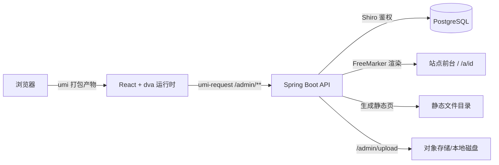
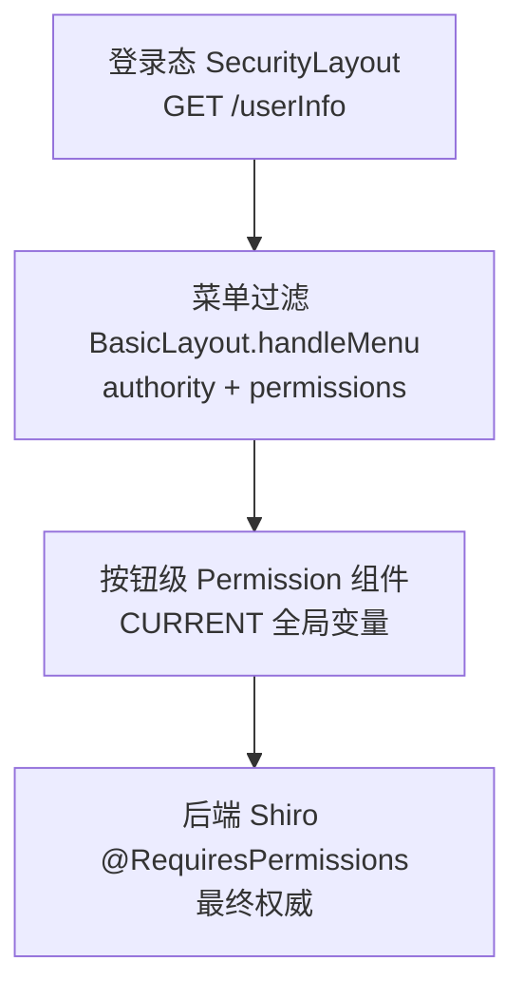

# faster-framework-cms-web 项目分析报告

> **分析对象**：`/opt/projects/faster-framework-cms-web`（分支 `master`，提交 `2bf817f 初始化`，Apache-2.0）
> **生成时间**：2026-11-13 09:38（Asia/Shanghai）
> **分析方法**：全量静态代码审查（104 个受版本控制文件 / 约 5.4k 行），并结合配套后端仓库 `faster-framework-cms-api` 的 Controller 与权限注解核对接口契约。
> **重要前提**：仓库内**没有 `node_modules`、没有 lockfile**，本次**未执行安装、构建、测试与浏览器验证**。文中标注“高置信”的结论来自代码推演；标注“待验证”的条目需要在可运行环境中确认。
> **版本提示（2026-11-13）**：项目已完成 Ant Design Pro v5 / antd 5 / umi 4 升级，本报告中的依赖版本与部分缺陷结论已被 [MIGRATION.md](MIGRATION.md) 取代，请结合阅读。

---

## 目录

- [0. 结论速览](#0-结论速览)
- [1. 项目概况](#1-项目概况)
- [2. 架构分析](#2-架构分析)
- [3. 功能模块](#3-功能模块)
- [4. 接口与数据契约](#4-接口与数据契约)
- [5. 缺陷与风险清单](#5-缺陷与风险清单)
- [6. 安全评估](#6-安全评估)
- [7. 性能评估](#7-性能评估)
- [8. 可维护性评估](#8-可维护性评估)
- [9. 工程化与交付](#9-工程化与交付)
- [10. 风险矩阵](#10-风险矩阵)
- [11. 改进路线图](#11-改进路线图)
- [12. 待确认问题](#12-待确认问题)
- [附录](#附录)

---

## 0. 结论速览

**一句话结论**：这是一个 **2019 年代技术栈（umi 2 + Ant Design 3 + React 16.8 + dva）的 CMS 后台管理前端**，业务功能覆盖较完整（登录、栏目、文章、站点静态化、用户/角色/权限/字典），但**工程化、安全基线与运行时正确性均不足以直接用于生产**；它更像一份“可运行的模板/教学参考”，需要一轮系统性修复与升级。

**关键数字**

| 指标 | 数值 |
|---|---|
| 受版本控制文件 | 104 |
| `src` 文件 | 83（58 个 `.jsx`、12 个 `.js`、11 个 `.less`、2 个图片） |
| 代码行数 | JSX 4,057 / JS 455 / LESS 566 / 配置 359（约 5.4k） |
| 页面组件 | 35 个 `.jsx`（含文章、栏目两套各 6 个弹窗表单） |
| 复用组件 | 20 个 `.jsx` |
| 后端接口调用点 | 约 40 处，覆盖 30 余个端点 |
| 自动化测试 | **0** |
| Lint / 格式化配置 | **无**（仅装了 `@umijs/fabric` 依赖） |
| 构建锁文件 | **无**（`yarn.lock` / `package-lock.json` 被 `.gitignore` 忽略） |
| CI / Docker / Nginx 配置 | **无** |

**Top 10 风险（按影响排序）**

| # | 风险 | 等级 | 位置 |
|---|---|---|---|
| 1 | 生产/测试环境 API 地址硬编码为 `http://127.0.0.1:8080/admin`，且为 HTTP | **P0** | [config.prod.js](config/config.prod.js)、[config.test.js](config/config.test.js) |
| 2 | 无 lockfile + umi2/webpack4 + Node 24，依赖与构建不可复现 | **P0** | [package.json](package.json) |
| 3 | 富文本/图片上传绕过统一请求封装，**不带 `Auth-Token`**，也无统一错误处理 | **P0** | [Upload/index.jsx:60](src/common/components/Upload/index.jsx)、[UploadImg/index.jsx:70](src/common/components/UploadImg/index.jsx) |
| 4 | “记住密码”把**明文账号密码**写入 `localStorage`；token 同样存 `localStorage` | **P0** | [login/index.jsx:26-28](src/common/pages/login/index.jsx) |
| 5 | 401 后只清 token、不清 dva 用户态，登录态判断仍为真 → 可能循环 401 | **P0** | [request.js:42-43](src/common/utils/request.js) |
| 6 | 多页签实现把所有 TabPane 渲染成**同一个当前路由 children**，每开一个页签就多挂载一份页面 | **P1** | [Tabs/index.jsx:129-136](src/common/components/Tabs/index.jsx) |
| 7 | 弹窗刷新依赖 `{...this.refs}` 注入 `tableList`，首次渲染时 refs 为空 → 保存后 `reload` 可能抛错 | **P1** | [Modal/index.jsx:19-21](src/common/components/Modal/index.jsx) |
| 8 | 列表 `reload()` 丢失筛选条件；搜索不重置页码 | **P1** | [TablePro/index.jsx:56-70](src/common/components/TableList/TablePro/index.jsx) |
| 9 | 前端权限码、Mock 权限码、后端 `@RequiresPermissions` 三方不一致；路由级权限未生效 | **P1** | [routers.js](config/routers.js) / [SectionController](https://github.com/faster-framework/faster-framework-cms-api) |
| 10 | `/site/generate` 生成整站静态页受 5s 全局超时限制，必然失败（前端报错、后端继续跑） | **P1** | [request.js:58](src/common/utils/request.js)、[site/index.jsx:29](src/pages/site/index.jsx) |

**适用性判断**

- ✅ 适合：作为中小型 CMS 后台的业务原型、内部管理工具参考、学习 umi2/dva/Ant Design Pro 组合的历史样本。
- ⚠️ 有条件可用：完成 P0/P1 修复（预计 1–2 周）后可做内网后台。
- ❌ 不适合：直接部署公网、直接交付客户、作为新项目起点（应升级技术栈或重写）。

---

## 1. 项目概况

### 1.1 项目定位

README 表明：Faster-CMS 是**基于 Faster-Framework 与 Faster-Admin 构建的内容管理系统**，后端使用 **FreeMarker** 作为模板引擎，用于快速搭建企业官网、新闻资讯站点；本仓库是其中的**后台管理前端**（`faster-cms-web`），配套后端为 `faster-cms-api`（同时包含后台接口 + 站点前台 + 静态化）。

- 站点前台由后端 FreeMarker 渲染（`/`、`/a/{id}`、栏目页），后台还可“生成静态站点”。
- 后台前端通过 REST 与 `/admin/**` 接口通信，认证头为 `Auth-Token`。
- 上游仓库于 **2026-01-04 新建**（`created_at`），仅 1 次提交、0 star、无 release，说明这是一次**历史代码的重新发布**，而非持续维护项目；代码本身停留在 2019 年前后的依赖版本。

### 1.2 上游与版本信息

| 项 | 值 |
|---|---|
| 包名 | `faster-admin-web`（与目录 `cms-web` 不一致，说明源自通用后台模板） |
| 版本 | `1.0.0`，`private: true` |
| 描述 | “后台管理通用模板” |
| 许可证 | Apache License 2.0 |
| Node 引擎声明 | `>=10.0.0`（过宽，未锁定） |
| 配套后端语言构成 | Java 约 177KB、PLpgSQL 约 20KB（PostgreSQL）、FreeMarker 约 4KB（GitHub 语言统计，按字节） |
| 后端关键依赖 | Spring Boot + Apache Shiro + MyBatis-Plus + PostgreSQL + FreeMarker |

### 1.3 技术栈

| 层次 | 技术 | 版本 | 状态与备注 |
|---|---|---|---|
| 构建/开发服务 | umi | `^2.9.6` | 2019 年版本，webpack 4 |
| React | react / react-dom | `^16.8.6` | 类组件为主，无 Hooks 使用 |
| UI | antd | `^3.24.2` | v3，2020 年停止维护 |
| 布局 | `@ant-design/pro-layout` | `~4.8.3` | ProLayout 早期版本 |
| 状态 | dva | `^2.4.1`（经 umi-plugin-react） | 4 个 model，全局 `g_app._store` 访问 |
| 请求 | umi-request | `^1.2.6` | 统一封装 + 拦截器 |
| 富文本 | braft-editor | `^2.3.8` | 基于 draft-js，长期未维护 |
| 其他 | moment、lodash、mockjs、@antv/data-set、classnames、omit.js、path-to-regexp、qs、react-copy-to-clipboard 等 | 2019 年版本 | **多数未被使用**（见 §8.3） |
| 语言 | JavaScript + JSX | — | 无 TypeScript、无 PropTypes |
| 样式 | LESS + CSS Modules（自定义 `getLocalIdent`） | — | 大量 `:global` 覆盖 |
| 测试 | enzyme（devDependency） | `^3.9.0` | **无任何测试文件** |
| 质量工具 | `@umijs/fabric`、import-sort | — | **无配置文件、无 npm script** |

### 1.4 代码规模分布

| 目录 | 文件数 | 行数（约） | 说明 |
|---|---|---|---|
| `src/pages`（业务页） | 20 | 1,607 | 栏目、文章、站点、控制台 |
| `src/common/pages`（系统页 + 登录） | 15 | 1,268 | 用户/角色/权限/字典/登录/404 |
| `src/common/components` | 23 | 1,674 | 表格、弹窗、上传、编辑器、权限、页签 |
| `src/common/layouts` | 4 | 256 | 安全布局、基础布局、登录布局 |
| `src/common/utils` | 6 | 236 | 请求、字典、树、权限、工具 |
| `src/models` | 4 | 193 | global / user / dict / settings |
| `config` | 8 | 359 | 路由、插件、环境、默认设置 |
| `mock` | 6 | 6 个文件（压缩 JSON 单行） | Mock 数据，覆盖不完整 |

### 1.5 目录结构

```text
faster-framework-cms-web/
├── config/
│   ├── config.js              # umi 主配置：插件、路由、主题、CSS Modules、manifest
│   ├── config.dev.js          # BASE_API（支持 /mock 或 127.0.0.1:8080/admin）
│   ├── config.prod.js         # BASE_API 硬编码 localhost（问题）
│   ├── config.test.js         # 与 prod 完全相同（无差异化）
│   ├── defaultSettings.js     # 标题、主色、布局、版权
│   ├── plugin.config.js       # 主题色替换（仅非生产）+ splitChunks
│   ├── routers.js             # 业务路由 + flatRoutes 扁平化（副作用）
│   └── router-modules.js      # 内容管理/站点管理路由模块
├── mock/                      # umi mock（/mock/**），仅覆盖登录 + 部分系统管理
├── public/favicon.png
├── src/
│   ├── app.js                 # onRouteChange：每次路由变化拉取字典
│   ├── models/                # global（页签/折叠/loading）、user、dict、settings
│   ├── common/
│   │   ├── layouts/           # SecurityLayout → BasicLayout；LoginLayout
│   │   ├── components/        # TableList/Modal/Tabs/Upload/UploadImg/BraftEditor/
│   │   │                      # FixedRow/Permission/Authorized/GlobalHeader/PageLoading
│   │   ├── pages/             # login、404、sys/{user,role,permission,dict}
│   │   └── utils/             # request、dict、treeUtils、authority、utils
│   └── pages/
│       ├── Dashboard.jsx      # “欢迎来到后台管理”
│       ├── section/           # 栏目：index + Add/Edit/Sort/Publish/Show/Top
│       ├── article/           # 文章：index（左树）+ List + Add/Edit/Sort/Publish/Show/Top
│       └── site/              # 生成静态站点 / 站点预览
└── package.json / README.md / LICENSE / jsconfig.json / .editorconfig
```

---

## 2. 架构分析

### 2.1 总体运行形态



后台前端是**纯 SPA**：浏览器历史路由（`history: 'browser'` 默认，未显式配置）、`hash: true` 静态资源指纹、`manifest` 输出。部署时需由 Web 服务器做 **history fallback**（否则刷新子路由 404），仓库未包含任何 Nginx/部署配置。

### 2.2 启动与运行时链路

1. `src/pages/document.ejs` 生成 HTML（内联首屏 Spin，`lang="en"`，标题来自 `TITLE` 全局常量）。
2. umi 启动 → `src/app.js` 注册 `onRouteChange`。
3. 访问 `/login`：`LoginLayout`（DocumentTitle + Spin）→ 登录页。
4. 访问其他路径：`SecurityLayout` 挂载 → `dispatch('user/fetchCurrent')`（`GET /userInfo`）。
   - 无登录态：渲染 `PageLoading`，随后 `message.error` + `Redirect` 到 `/login?redirect=...`。
   - 有登录态：渲染 `BasicLayout`。
5. `BasicLayout`：`ProLayout` + 菜单权限过滤 + 面包屑 + 页签 `Tabs` + 右上角用户下拉。
6. 每次路由变化：`app.js` 请求 `GET /sys/dict/all` → `dict/refreshDict`，供 `DictUtils` 同步读取。
7. 页面级 CRUD 全部走 `TableList` 组合组件（搜索 / 操作 / 表格 / 弹窗表单）。

### 2.3 路由与布局

采用“双层布局”：

- `/login` → `LoginLayout` → `login` 页面（在 `SecurityLayout` 之外，避免登录页触发鉴权）。
- `/` → `SecurityLayout` → `BasicLayout` → 业务路由。
- 业务路由来自 [config/routers.js](config/routers.js)（系统管理）+ [config/router-modules.js](config/router-modules.js)（内容/站点），末尾兜底 `404`。

**路由矩阵**

| 路径 | 组件 | 菜单名 | 菜单权限（前端） | 备注 |
|---|---|---|---|---|
| `/` | `./Dashboard` | 控制台 | 无 | 仅欢迎卡片 |
| `/sys` | —（无组件） | 系统管理 | 无 | 纯分组 |
| `/sys/user` | `../common/pages/sys/user` | 用户管理 | `users:manage` | 列表需后端 `users:list` |
| `/sys/role` | `../common/pages/sys/role` | 角色管理 | `roles:manage` | 列表需 `roles:list` |
| `/sys/permission` | `../common/pages/sys/permission` | 权限管理 | `permissions:manage` | 列表需 `permissions:tree` |
| `/sys/dict` | `../common/pages/sys/dict` | 字典管理 | `dict:manage` | 列表需 `dict:list` |
| `/content` | —（无组件） | 内容管理 | 无 | 纯分组 |
| `/content/section` | `./section` | 栏目管理 | `section:manage` | 表格需 `section:tree` |
| `/content/article` | `./article` | 文章管理 | `article:manage` | 列表需 `article:list` |
| `/site` | `./site` | 站点管理 | `site:manage` | 生成需 `site:manage` |
| `*` | `../common/pages/404` | — | 无 | 404 |

**扁平化算法**（[routers.js:55-72](config/routers.js)）：在模块加载时递归把子路由 `path` 拼成绝对路径（`parent.path + item.path`），产出 `flatRoutes` 供 `RightContent` 面包屑与 `Tabs` 匹配。问题：

- **原地修改路由配置对象**（副作用），且依赖 `item.path` 以 `/` 开头；若出现相对路径（无前导 `/`）会拼错。
- 该算法在 Node 侧执行一次，`flatRoutes` 通过 webpack `define` 注入浏览器，属于“构建期数据”，无法响应动态路由（如后续要加详情页需改构建配置）。

**路由级权限缺失**：`authority` 只被 `BasicLayout.handleMenu` 用于**隐藏菜单项**；直接输入 URL 仍会渲染页面（数据由后端 403 保护）。仓库内置的 `AuthorizedRoute` 从未使用，说明该能力被“半途弃用”。

### 2.4 状态管理（dva）

| namespace | 文件 | 状态 | 作用 |
|---|---|---|---|
| `global` | [models/global.js](src/models/global.js) | `collapsed`、`loading`、`tabList`、`activeTab` | 侧栏折叠、全局 loading、页签增删 |
| `user` | [models/user.js](src/models/user.js) | `currentUser` | 登录用户与权限列表 |
| `dict` | [models/dict.js](src/models/dict.js) | `dictList` | 全量字典缓存 |
| `settings` | [models/setting.js](src/models/setting.js) | ProLayout 设置 | 从 URL 参数读取主题设置 |

特点与问题：

- **大量直接访问私有 store**：`window.g_app._store` 出现在 [request.js](src/common/utils/request.js)、[dict.js](src/common/utils/dict.js)、[authority.js](src/common/utils/authority.js)、[app.js](src/app.js)。这使模块与 umi 运行时强耦合，无法单测，也无法迁移到其他框架。
- `global.loading` 是**布尔值而非计数器**：并发请求会提前关闭 loading（详见 §5）。
- `setting` model 读取 URL 的 `primaryColor` / `colorWeak`，但主题替换插件**只在非生产启用**（[plugin.config.js](config/plugin.config.js)），且设置抽屉组件已被删除，属于“半拆除功能”。
- `dict` 没有组件通过 `connect` 订阅，`DictUtils` 是“渲染时读 store”的快照式读取，字典晚到不会触发 UI 更新（§5.3）。

### 2.5 请求层

[request.js](src/common/utils/request.js) 基于 umi-request：

```js
const request = extend({
  prefix: BASE_API,
  timeout: 5000,
  headers: { 'Content-Type': 'application/json; charset=utf-8' },
  credentials: 'include',
  errorHandler,
});
```

- 请求拦截器：`global/loadingShow`，写入 `Auth-Token`。
- 响应拦截器：`global/loadingHide`。
- 错误处理：401 清 token 并 `router.push('/login')`；其余状态码按映射弹 `message.error`，最后 `throw err`。
- `message.config({ top: '40%', maxCount: 1, duration: 2 })`：同时最多 1 条提示，连续错误会被吞掉。

**关键实现问题**：请求拦截器把 `options.headers` **整体替换**为 `{ 'Auth-Token': token }`：

```js
options.headers = { 'Auth-Token': token };
```

这会丢弃 `extend` 上配置的 `Content-Type: application/json`，也会丢弃调用方显式传入的 `multipart/form-data`（`BraftEditor`）。是否导致后端 415 取决于 umi-request 的默认补全行为，属**需实测项**，但该写法本身是明确缺陷（应使用 `{...options.headers, 'Auth-Token': token}`）。

### 2.6 权限体系

四层权限：



- `RenderAuthorize(currentUser.permissions)` 每次渲染时把权限写入**模块级可变变量** `CURRENT`（[renderAuthorize.js:4](src/common/components/Authorized/renderAuthorize.js)），随后 `Permission` 调用 `check()` 读取 `CURRENT`。
- 该设计依赖“`BasicLayout` 先渲染菜单、再渲染子页面”的隐式顺序；一旦顺序变化或脱离布局渲染，`CURRENT` 为 `'NULL'`，所有按钮被隐藏。
- 权限判定仅作用于 UI；真正的鉴权在后端（正确做法），但前端**没有 403 页面**，越权访问只表现为请求报错。
- `getAuthority()`（[authority.js](src/common/utils/authority.js)）支持把 JSON 字符串解析为数组，但**从未被使用**；`handleMenu` 直接使用 `currentUser.permissions` 原值。若后端把权限序列化为字符串，菜单会全部消失（待验证）。

**权限码三方不一致**（详见 §4.3）：

| 层 | 例子 | 问题 |
|---|---|---|
| 前端菜单 | `section:manage`、`article:manage`、`site:manage` | 与后端细粒度权限不同名 |
| 前端按钮 | `section:add`、`article:modify`、`users:delete`… | 漏掉 `*:list` / `*:info` / `section:tree` |
| 后端 Shiro | `section:list`、`section:tree`、`article:info`、`users:roles:list`… | 权威来源 |
| Mock 数据 | `sysDict:*`、`video:*` | 既非前端码也非后端码，明显来自其他模板 |

### 2.7 组件体系

| 组件 | 作用 | 设计要点 / 问题 |
|---|---|---|
| `TableList` | 组合 Search + Action + Table + Modal 的 CRUD 容器 | 通过 `React.Children` + `displayName === 'Form(Search)'` 注入 `handleSearch`；通过 `onRef` 回填 refs |
| `TableList/Search` | 查询表单，自动折叠/展开 | `getFieldDecorator(item.props.name)(item)`；4 个字段以上才显示“展开” |
| `TableList/TablePro` | 远程分页/树形表格 + 多选 | 分页参数 `current`/`size`，响应 `records`/`total`；`reload` 丢筛选 |
| `TableList/TablePro/Action` | 操作列（`displayName = ColumnAction`） | 由 `TablePro` 识别并生成 `title='操作'` 列 |
| `TableList/Actions` | 工具栏，自动给按钮加间距 | 对 `Permission` 子节点做二次克隆，逻辑重复 |
| `Modal`（自定义） | 受控弹窗 + 表单提交协议 | `show(record)`、子组件 `onOk(modal)`、`hideAndRefresh()`；**依赖 `{...this.refs}` 注入 tableList** |
| `FixedRow` | 表单栅格（默认/上传/编辑器/整行） | 全局 class，固定 label 120px |
| `Tabs` | 多页签导航 | **每个 TabPane 渲染同一 children**（§5.2） |
| `Permission` | 按钮级权限 | 依赖全局 `CURRENT` |
| `Authorized/*` | Ant Design Pro 权限组件移植 | 大部分（`AuthorizedRoute`、`Secured`）未被使用 |
| `Upload` / `UploadImg` | 文件/图片上传 | 直传 `BASE_API + '/upload'`，绕过拦截器；`getDerivedStateFromProps` 覆盖上传中状态 |
| `BraftEditor` | 富文本 | 媒体上传走 `request.post('/upload')`，但 Content-Type 头会被拦截器覆盖 |
| `GlobalHeader/RightContent` | 面包屑 + 用户下拉 | 面包屑映射在 `constructor` 中一次性构建（可能过期） |
| `PageLoading` | 全屏 loading | — |

### 2.8 构建与环境

| 环境 | 命令 | API 前缀 |
|---|---|---|
| dev | `npm run dev`（`UMI_ENV=dev`） | `http://127.0.0.1:8080/admin` |
| mock | `npm run mock`（`UMI_ENV=dev MOCK=true`） | `/mock`（由 umi mock 提供） |
| test | `npm run test` → `UMI_ENV=test umi build` | **同一 localhost 地址** |
| prod | `npm run prod` → `UMI_ENV=prod umi build` | **同一 localhost 地址** |

- 注意：`test` 脚本不是“跑测试”，而是“以 test 环境构建”，命名具有误导性；仓库也没有测试可跑。
- `BASE_API` 通过 webpack `define` 注入，是**编译期常量**，无法在部署后通过环境变量修改；每次换环境都要重新构建，且当前三套环境地址相同。
- 主题色替换插件只在 `NODE_ENV !== 'production'` 时启用；`splitChunks` 只针对 `bizcharts/@antv` 等**未使用**的包，属于模板残留。
- `targets.ie = 11` + `browserslist not ie <= 10` 表明曾要求兼容 IE11，但 antd 3 + braft-editor 在 IE11 下的实际兼容性未验证。
- `hash: true`、`manifest.basePath: '/'`；未配置 `base`/`publicPath`，若部署在子路径（如 `/admin-web/`）需要额外调整。

### 2.9 数据字典机制

- 路由变化 → `GET /sys/dict/all` → `dict.dictList`。
- 业务代码通过 `DictUtils.name(type, value)` / `value(type, name)` / `listByType(type)` **同步读取 store**。
- 使用场景：文章标题外链（`site-url`）、栏目模板下拉（`section-template` / `article-template`）、站点预览地址（`site-url`）。
- 局限：
  1. 无订阅 → 字典更新后已渲染组件不刷新；
  2. 每次路由 change 都请求一次，开销与失败提示（见 §5.1）；
  3. `listByType` 依赖字典类型命名约定，无类型校验，拼错类型时静默返回空数组。

---

## 3. 功能模块

### 3.1 登录与鉴权

**页面**：[login/index.jsx](src/common/pages/login/index.jsx)、[LoginLayout.jsx](src/common/layouts/LoginLayout.jsx)、[SecurityLayout.jsx](src/common/layouts/SecurityLayout.jsx)

**流程**：加载验证码 `GET /captcha` → 提交 `POST /login`（账号、密码、验证码、`captchaToken`）→ 保存 token → 跳转 `/`。登录成功后由 `SecurityLayout` 拉取 `/userInfo` 获得 `name` 与 `permissions`。

**已有能力**：验证码刷新、记住账号密码、回车提交、登录错误提示、过期跳转。

**问题**：

- 明文保存密码（P0）。
- 忽略 `SecurityLayout` 写入的 `redirect` 参数，登录后总是回 `/`。
- 已登录访问 `/login` 不重定向。
- 登录页仍会触发 `app.js` 的字典请求（无 token → 401 提示）。
- 退出登录只删 token，不清理 dva 用户态（P0）。

### 3.2 控制台

`Dashboard.jsx` 仅一张“欢迎来到后台管理”卡片，`CodePreview` 组件为死代码。无统计数据、无快捷入口。

### 3.3 栏目管理

**页面**：[section/index.jsx](src/pages/section/index.jsx) 列表 + 6 个弹窗子组件（Add/Edit/Sort/Publish/Show/Top）。

**能力**：树表展示（`GET /section/tree`，`pagination=false`）、新增下级（自动带入父级 `code + "-"`）、修改、排序、发布/展示/置顶开关、批量删除、刷新。

**字段**：图片、资源文件、父级栏目、名称、编码、顺序、模板类型（普通/分页）、栏目模板、跳转链接、文章模板、发布/展示/置顶状态、描述、富文本内容。

**问题**：

- “发布/展示/置顶”三个按钮使用 `article:modify` 权限（[section/index.jsx:40-46](src/pages/section/index.jsx)），复制粘贴错误。
- 树表勾选父节点会递归勾选子节点，但跨页/多次操作时 `flatData` 仅当前数据，批量删除可能不完整。
- 保存后刷新依赖 Modal 的 `tableList` 注入（见 §5.2），栏目页无状态更新，**高置信会抛错**。
- 栏目模板下拉依赖字典，字典未就绪时为空。

### 3.4 文章管理

**页面**：[article/index.jsx](src/pages/article/index.jsx)（左栏目树 + 右列表）、[ArticleList.jsx](src/pages/article/ArticleList.jsx)、6 个弹窗。

**能力**：按栏目过滤、标题/编码/发布/展示/置顶筛选、添加（仅选中栏目后可用）、修改、发布、展示、置顶、排序、克隆、删除、标题外链到前台 `site-url + "a/" + id`。

**问题**：

- 左侧树根节点判断错误：用 `'0-0'` 表示根，但实际根节点 `value = '0'`（[article/index.jsx:29,36](src/pages/article/index.jsx)）→ 选中“站点”时按 `sectionId=0` 过滤，结果为空；`defaultExpandedKeys: ['0-0']` 无效。
- 通过 `setTimeout(0)` + `refs.articleList.refs.tableList.reload()` 跨两层访问子组件，脆弱。
- 克隆把整条记录（含 `id`、`createDate`）POST 回后端，依赖后端忽略主键；提示文案也只说“仅可克隆不存在编码的文章”。
- 新增按钮仅在选中栏目后显示，但弹窗始终挂载，`sectionId` 可能为 `undefined`；提交前无二次校验。
- 详情/编辑/发布等每次打开都重新 `GET /article/{id}`，无缓存。

### 3.5 站点管理

**页面**：[site/index.jsx](src/pages/site/index.jsx)

**能力**：`POST /site/generate` 生成静态站点；`站点预览` 打开字典 `site-url`。

**问题**：生成整站是长耗时任务，却受全局 5s 超时限制；按钮无 loading/禁用；`href` 可能为 `undefined`；无生成结果/日志反馈。

### 3.6 系统管理

#### 用户管理

- 列表 `GET /sys/users`、新增、编辑、删除、修改密码、重置密码（默认 `123456`）、选择角色（`GET /sys/users/{id}/roles` + `PUT .../roles/choose`）。
- 问题：批量删除按钮权限写成 `users:add`（[user/index.jsx:96](src/common/pages/sys/user/index.jsx)）；“选择角色”弹窗需要 `users:roles:list` + `roles:list`，但前端只检查 `users:roles:choose`；重置密码默认值弱。

#### 角色管理

- 列表、新增、编辑、删除、权限设置（树表多选）。
- 问题：删除按钮权限写成 `roles:add`（[role/index.jsx:70](src/common/pages/sys/role/index.jsx)）；权限设置弹窗需要 `roles:permissions:list` + `permissions:tree` + `roles:permissions:choose`，前端只校验第一个；“权限设置”保存时缺少 choose 权限会 403。

#### 权限管理

- 树表展示 `GET /sys/permissions/tree`、新增（父级树选择）、编辑、删除、刷新。
- 问题：新增弹窗需要 `permissions:list`（拉取父级树），但入口只要求 `permissions:add`；无拖拽排序；无编码唯一性校验。

#### 字典管理

- 列表（默认 `showStatus: 1`）、新增、编辑、排序、删除。
- 问题：后端权限码为 `dict:*`，Mock 为 `sysDict:*`；前端菜单为 `dict:manage`，三方不一致；`showStatus` 在新增表单中不可编辑，默认值依赖后端。

---

## 4. 接口与数据契约

### 4.1 通用约定

| 项 | 约定 |
|---|---|
| 前缀 | `BASE_API` = `http://127.0.0.1:8080/admin`（dev/prod/test）或 `/mock`（mock） |
| 认证 | 请求头 `Auth-Token: <token>`，token 来自 `localStorage.token` |
| 凭证 | 同时发送 `credentials: 'include'`（Cookie） |
| 分页请求 | `current`（页码，从 1 开始）、`size`（每页条数） |
| 分页响应 | `{ records, total, size, current, pages }` |
| 删除 | `DELETE` + JSON 数组 body（如 `[1,2]`） |
| 错误 | HTTP 状态码 + `{ code, message }`；401 特殊处理 `code=1006` |
| 字典 | `GET /sys/dict/all` 返回扁平数组 `{ name, type, dictValue, sort, showStatus }` |
| 上传 | `POST /admin/upload`，字段名 `file`，返回 `{ url }` |
| 树结构 | 扁平列表含 `id/parentId`，前端单遍组装（依赖父先于子） |

### 4.2 接口清单（前端调用 → 后端权限）

> 后端权限来自配套仓库 Controller 的 `@RequiresPermissions`，已逐项核对。

| 前端调用点 | 方法 & 路径（拼接后） | 后端权限 | 前端是否校验 | 备注 |
|---|---|---|---|---|
| 登录页 | `POST /login` | 无（公开） | — | 需 `captchaToken` |
| 登录页 | `GET /captcha` | 无（公开） | — | 返回 `{img, token}` |
| SecurityLayout | `GET /userInfo` | 需登录 | — | 返回 `{name, permissions}` |
| 退出 | `DELETE /logout` | 需登录 | — | 清 token |
| 全局 | `GET /sys/dict/all` | 需登录（无注解） | — | 每次路由变化都调 |
| 字典列表 | `GET /sys/dict` | `dict:list` | 仅菜单 `dict:manage` | 分页 |
| 字典详情 | `GET /sys/dict/{id}` | `dict:info` | 无 | 弹窗打开即请求 |
| 字典新增 | `POST /sys/dict` | `dict:add` | `dict:add` | — |
| 字典更新 | `PUT /sys/dict/{id}` | `dict:modify` | `dict:modify` | 支持部分字段 |
| 字典删除 | `DELETE /sys/dict/delete` | `dict:delete` | `dict:delete` | body 为 id 数组 |
| 栏目树（文章页） | `GET /section` | `section:list` | 仅菜单 `article:manage` | 字典数据同源 |
| 栏目树（栏目页） | `GET /section/tree` | `section:tree` | 仅菜单 `section:manage` | `pagination=false` |
| 栏目详情 | `GET /section/{id}` | `section:info` | 无 | — |
| 栏目新增/更新 | `POST /section`、`PUT /section/{id}` | `section:add` / `section:modify` | 有 | — |
| 栏目删除 | `DELETE /section/delete` | `section:delete` | 有 | — |
| 文章列表 | `GET /article` | `article:list` | 仅菜单 `article:manage` | 分页 |
| 文章详情 | `GET /article/{id}` | `article:info` | 无 | 每个弹窗都请求 |
| 文章新增/更新 | `POST /article`、`PUT /article/{id}` | `article:add` / `article:modify` | 有 | 支持部分字段 |
| 文章删除 | `DELETE /article/delete` | `article:delete` | `article:delete` | — |
| 站点生成 | `POST /site/generate` | `site:manage` | 仅菜单 | 长耗时 |
| 用户列表 | `GET /sys/users` | `users:list` | 仅菜单 `users:manage` | — |
| 用户详情 | `GET /sys/users/{id}` | `users:info` | 无 | — |
| 用户新增/更新/删除 | `POST /sys/users`、`PUT /sys/users/{id}`、`DELETE /sys/users/delete` | `users:add/modify/delete` | 有（工具栏删除权限错误） | — |
| 修改密码 | `PUT /sys/users/{id}/password/change` | `users:password:change` | `users:password:change` | — |
| 重置密码 | `PUT /sys/users/{id}/password/reset` | `users:password:reset` | `users:password:reset` | 固定 123456 |
| 选择角色 | `PUT /sys/users/{id}/roles/choose` | `users:roles:choose` | `users:roles:choose` | — |
| 用户角色列表 | `GET /sys/users/{id}/roles` | `users:roles:list` | **未校验** | 打开弹窗即 403 风险 |
| 角色列表 | `GET /sys/roles` | `roles:list` | 仅菜单 `roles:manage` | 用户选角色弹窗也复用此接口 |
| 角色详情 | `GET /sys/roles/{id}` | `roles:info` | 无 | — |
| 角色增删改 | `POST /sys/roles`、`PUT /sys/roles/{id}`、`DELETE /sys/roles/delete` | `roles:add/modify/delete` | 有（工具栏删除权限错误） | — |
| 角色权限列表 | `GET /sys/roles/{id}/permissions` | `roles:permissions:list` | `roles:permissions:list` | — |
| 角色权限保存 | `PUT /sys/roles/{id}/permissions/choose` | `roles:permissions:choose` | **未校验** | 缺权限则 403 |
| 权限树 | `GET /sys/permissions/tree` | `permissions:tree` | 仅菜单 `permissions:manage` | — |
| 权限平铺 | `GET /sys/permissions` | `permissions:list` | 无（新增弹窗） | 缺权限则父级树为空 |
| 权限详情/增删改 | `GET/PUT/DELETE/POST /sys/permissions...` | `permissions:info/add/modify/delete` | 部分 | — |
| 上传 | `POST /upload` | 取决于框架（`AbstractUploadController`） | — | **不带 token**（见 §5.1） |

### 4.3 权限矩阵差异（重点）

1. **“管理”权限 ≠ “列表”权限**：前端菜单用 `*:manage`，后端接口用 `*:list` / `*:tree` / `*:info`。若管理员只被授予 `article:manage` 而未被授予 `article:list`，页面能打开但列表 403。应统一以“后端细粒度权限 + 前端按接口校验”为原则。
2. **前端漏校验**：`article:list`、`article:info`、`section:list`、`section:info`、`section:tree`、`users:list`、`users:info`、`users:roles:list`、`roles:list`、`roles:info`、`roles:permissions:choose`、`permissions:list`、`permissions:tree`、`permissions:info`。
3. **跨模块耦合**：用户“选择角色”弹窗复用 `GET /sys/roles`，需要 `roles:list`；角色“权限设置”弹窗复用 `GET /sys/permissions/tree`，需要 `permissions:tree`。这导致“用户管理员”必须同时拥有角色/权限模块的读权限，权限模型不内聚。
4. **Mock 数据失真**：`mock/login.js` 的 `userInfo.permissions` 含 `video:*`、`sysDict:*`，缺 `article:*`、`section:*`、`site:*`、`dict:*`。在 `npm run mock` 下：
   - 侧栏只能看到“系统管理”（用户/角色/权限），**字典菜单被隐藏**；
   - 内容管理、站点管理菜单被隐藏；
   - 即使通过 URL 进入，接口也不存在（`/mock/article`、`/mock/section`、`/mock/site` 均未定义）→ 404。
5. **路由级权限缺失**：`authority` 仅控制菜单显示，直接访问 URL 仍渲染页面；无 403 页面，只有接口报错提示。

### 4.4 数据模型（由前端表单反推）

**Section（栏目）**

| 字段 | 类型 | 说明 |
|---|---|---|
| `id` | string（雪花 ID） | 主键，前端按字符串处理 |
| `parentId` | number/string | 根为 `0` |
| `name` / `code` | string | 名称/编码（新增下级自动补 `父code-`） |
| `sort` | number | 排序 |
| `templateType` | 1/2 | 普通/分页 |
| `templatePath` / `articleTemplatePath` | string | 字典 `section-template` / `article-template` |
| `link` | string | 跳转链接 |
| `publishStatus` / `showStatus` / `topStatus` | 0/1 | 发布/展示/置顶 |
| `img` / `resourceUrl` | string | 图片/资源文件（逗号分隔多值） |
| `description` / `content` | string | 描述/富文本 |

**Article（文章）**：`title`、`code`、`sectionId`、`sort`、`publishStatus`、`showStatus`、`topStatus`、`description`、`content`、`img`、`resourceUrl`；后端另有 `publishDate`（前端不可编辑）。

**SysUser**：`account`、`password`、`name`；**SysRole**：`name`；**SysPermission**：`name`、`code`、`parentId`；**SysDict**：`name`、`dictValue`、`type`、`remark`、`sort`、`showStatus`。

> **主键精度风险**：后端使用 64 位雪花 ID。若 API 将其序列化为 JSON number，JS 会丢失精度（> 2^53）。Mock 与现有代码均按字符串处理，故后端必须配置 Long → String 序列化；这是隐式契约，需在联调中固定。

### 4.5 关键契约风险

1. **部分更新语义**：前端“发布/展示/置顶/顺序”只 PUT 一个字段。后端 `ArticleUpdateRequest` 无校验注解，若 Service 使用 MyBatis-Plus `updateById`（默认忽略 null）则安全；若改为全量覆盖会清空其他字段。需固定为“PATCH 语义”或在后端显式声明。
2. **上传字段名**：`Upload` 使用 antd 默认 `name="file"`；`BraftEditor` 也 append `file`。后端 `AbstractUploadController` 若要求其他字段名需调整。
3. **上传鉴权**：上传不经过 `request` 拦截器，不携带 `Auth-Token`；若 Shiro 过滤器对 `/admin/**` 全量鉴权，上传会 401（需确认白名单）。
4. **错误码 1006**：401 且 `code=1006` 时前端只弹提示、不跳登录，依赖 `SecurityLayout` 后续兜底；若用户态未清空，会停留在页面反复报错。
5. **Cookie + Token 双认证**：`credentials: 'include'` 要求后端 CORS 精确允许来源，不能使用 `*`；生产若前后端不同域需配置 `Access-Control-Allow-Credentials`。
6. **静态资源路径**：`manifest.basePath: '/'`，若后台部署在子路径需改 `base`，同时 history fallback 需要服务器配合。

---

## 5. 缺陷与风险清单

> 严重度定义：**P0** 阻断上线/安全；**P1** 主要功能错误或高概率故障；**P2** 体验/质量问题。

### 5.1 P0

#### P0-1 生产 API 地址硬编码 localhost

- 位置：[config.prod.js:3](config/config.prod.js)、[config.test.js:3](config/config.test.js)
- 现象：`BASE_API = 'http://127.0.0.1:8080/admin'`，生产构建产物在用户浏览器中请求**用户自己的 localhost**。
- 影响：生产完全不可用；若后台以 HTTPS 部署还会触发混合内容拦截。
- 修复：改为环境变量注入（构建期 `process.env.API_BASE`）或运行时配置（`window.__APP_CONFIG__` / `/config.json`）；生产必须 HTTPS。

#### P0-2 依赖与构建不可复现

- 位置：[package.json](package.json)、[.gitignore](.gitignore)（忽略 `yarn.lock`、`package-lock.json`）
- 现象：无锁文件；依赖全部使用 `^`/`~` 范围（antd ^3.24、umi ^2.9 可解析到 3.x/2.x 最新）；`engines.node >= 10`；当前环境 Node **v24.22.3**。
- 影响：
  - 今天重新 `npm install` 会解析到与 2019 年不同的版本，行为漂移；
  - umi2 基于 webpack 4，在 Node ≥17（OpenSSL 3）下常见 `ERR_OSSL_EVP_UNSUPPORTED`（md4），构建失败概率高；
  - 无 lockfile 意味着无法审计供应链。
- 修复：锁定 Node 版本（`.nvmrc`，建议 14/16）、生成并提交 lockfile、`npm ci`、在 CI 固化环境；中期升级 umi 4 / Vite。

#### P0-3 上传绕过统一请求封装，不带鉴权头

- 位置：[Upload/index.jsx:60](src/common/components/Upload/index.jsx)、[UploadImg/index.jsx:70](src/common/components/UploadImg/index.jsx)
- 现象：`action={BASE_API + '/upload'}` 由 antd `Upload` 直接发请求，不经 `umi-request` 实例，因此**不会带 `Auth-Token`**，也不会走统一错误处理与全局 loading。
- 影响：若后端对 `/admin/upload` 要求登录，图片/附件上传 401；即便后端放行，也缺失统一错误提示。
- 修复：改用 `customRequest`，内部调用 `request.post('/upload', { data: formData })`；或通过 `headers={{ 'Auth-Token': token }}` 显式补齐，并统一错误处理。
- 附带问题：`handleChange` 用 `fileList.map(item => item.url).join(",")`，上传中的文件 `url` 为 `undefined`，会把字符串 `"undefined"` 写入表单值；`getDerivedStateFromProps` 在每次父组件渲染时用 value 重建 `fileList`，会覆盖上传进度。

#### P0-4 明文保存账号密码

- 位置：[login/index.jsx:26-28,71,84](src/common/pages/login/index.jsx)
- 现象：勾选“记住密码”后 `localStorage.account/password` 明文存储，并在下次打开时作为 `initialValue` 回填；token 同样存 `localStorage`。
- 影响：任意 XSS（如富文本内容、第三方脚本）即可窃取后台凭据；共享电脑上凭据泄露。
- 修复：只记住账号；密码交给浏览器密码管理器；token 改存 `HttpOnly` Cookie（需要后端配合），或至少缩短有效期并加 CSRF 防护。

#### P0-5 401 后登录态未清理

- 位置：[request.js:37-44](src/common/utils/request.js)、[models/user.js](src/models/user.js)、[SecurityLayout.jsx:28](src/common/layouts/SecurityLayout.jsx)
- 现象：401 时执行 `localStorage.removeItem('token')` 和 `router.push('/login')`，但 dva `user.currentUser` 仍是旧对象；`SecurityLayout` 以 `Object.keys(currentUser).length > 0` 判定登录态，仍为真。
- 影响：用户可在“已登录”状态下来回跳转，接口持续 401；登录页与后台之间可能出现循环/白屏；权限判断使用过期权限。
- 修复：401 时 `dispatch({ type: 'user/saveCurrentUser', payload: {} })` 并清理页签/字典；统一在路由守卫中处理；区分“token 过期”和“无权限”。

### 5.2 P1

#### P1-1 多页签渲染模型错误（重复挂载）

- 位置：[Tabs/index.jsx:129-136](src/common/components/Tabs/index.jsx)
- 代码：

```jsx
<Tabs activeKey={routing.pathname} ...>
  {tabList.map((item, index) => (
    <TabPane tab={...} key={item.path}>
      <Spin ...>{children}</Spin>
    </TabPane>
  ))}
</Tabs>
```

- 现象：**每个页签都渲染同一个 `children`**（当前路由内容）。rc-tabs 会保留已激活过的 pane，因此打开 N 个页签后，当前页面会被挂载 N 份（隐藏的 pane 也参与渲染）。
- 影响：重复请求（每份实例各自 `componentDidMount` 拉数据）、重复弹窗、内存与事件泄漏；页签切换并不会恢复“原页面状态”，与用户对多页签的预期完全不符。
- 修复（任选）：
  1. 页签只做导航，内容区只渲染一次 `{children}`（最简单，推荐先做）；
  2. 真正的 keep-alive：按 `tabList` 缓存路由组件实例（`umi-plugin-keep-alive` 或自定义 `Route` + `display:none`），每个 tab 对应自己的组件与参数；
  3. 升级到 umi 4 后使用 `keepalive` 方案。

#### P1-2 弹窗刷新依赖 refs 注入，保存后可能崩溃

- 位置：[Modal/index.jsx:19-21](src/common/components/Modal/index.jsx)，各页面 `<ModalInfo ... {...this.refs}>`
- 代码：

```jsx
hideAndRefresh = () => {
  this.props.tableList.reload();
  this.hide();
};
```

- 现象：页面通过 `{...this.refs}` 把 `tableList` 作为 **prop** 传给弹窗，但 `this.refs` 在**首次 render 时为空对象**，refs 是挂载后才填充的；`{...this.refs}` 在 render 时被复制成静态 props。若不是 connected 组件，页面不会因表格内部 `setState` 而重渲染。
- 影响：
  - 栏目、用户、角色、权限、字典页首次进入即打开弹窗保存 → `this.props.tableList` 为 `undefined` → `TypeError`，弹窗不关闭（“保存成功”提示已弹出，用户困惑）；
  - 文章页只有在点击左侧栏目树（触发父组件 `setState` → 子组件重渲染）后，弹窗才拿到 `tableList`；
  - 高置信（静态推演），建议首轮联调优先复现。
- 修复：不要用 refs 传 props。让 Modal 接受 `onSuccess` 回调（页面内 `onSuccess={() => this.refs.tableList.reload()}`），或在 Modal 内用 `context`/回调注册；同时给 `hideAndRefresh` 加空值保护。

#### P1-3 `reload()` 丢失筛选条件

- 位置：[TablePro/index.jsx:56-63](src/common/components/TableList/TablePro/index.jsx)
- 现象：`reload()` 只传 `{ current: 1, size }`，未合并 `lastFilter`；`loadData` 只合并 `defaultParam`。
- 影响：用户设置筛选 → 新增/编辑/删除 → 列表恢复为无筛选（文章页），或只保留栏目过滤（`defaultParam`），用户需重新输入。
- 修复：

```js
reload() {
  this.loadData({ ...this.state.lastFilter, current: 1, size: this.state.pagination.pageSize });
}
```

#### P1-4 搜索不重置页码

- 位置：[TableList/index.jsx:14-16](src/common/components/TableList/index.jsx)、[TablePro/index.jsx:65-70](src/common/components/TableList/TablePro/index.jsx)
- 现象：搜索直接 `loadData(values)`，`loadData` 用 `this.state.pagination.current` 作为页码；若当前在第 3 页，则带新条件请求第 3 页。
- 影响：筛选结果不足 3 页时出现“空列表”，被误判为“没有数据”；用户必须手动回第 1 页。
- 修复：`handleSearch` 中重置 `pagination.current = 1` 后再加载；或 `loadData` 对“筛选条件变化”统一重置页码。

#### P1-5 栏目树根节点判断错误

- 位置：[article/index.jsx:29,36](src/pages/article/index.jsx)
- 现象：根节点构造为 `{ value: '0', title: '站点' }`，但选中判断写的是 `keys[0] == '0-0'`；`defaultExpandedKeys: ['0-0']` 同样无效。
- 影响：选择“站点”根节点时 `sectionId = '0'`，后端按栏目 0 查询 → 空列表；默认展开失效；用户以为系统没数据。
- 修复：`const isRoot = keys[0] === '0'; sectionId = isRoot ? '' : keys[0]`；`defaultExpandedKeys` 使用根节点 key。

#### P1-6 权限码复制粘贴错误

- 栏目页“发布/展示/置顶”使用 `article:modify`（[section/index.jsx:40-46](src/pages/section/index.jsx)）。
- 用户/角色列表**工具栏**的“删除”按钮使用 `users:add` / `roles:add`（[user/index.jsx:96](src/common/pages/sys/user/index.jsx)、[role/index.jsx:70](src/common/pages/sys/role/index.jsx)）。
- 影响：权限语义错误；有 `users:add` 的用户能看到删除按钮（点击后 403）；有栏目权限但无文章权限的管理员无法发布栏目。
- 修复：统一权限常量模块，集中定义并由 TS/ESLint 约束。

#### P1-7 `/site/generate` 超时

- 位置：[request.js:58](src/common/utils/request.js)（全局 5s）、[site/index.jsx:29](src/pages/site/index.jsx)
- 现象：整站静态化（遍历栏目/文章、渲染 FreeMarker、写文件）远超 5s。
- 影响：前端报“请求超时”，后端仍在生成；用户重复点击导致并发生成；无结果反馈。
- 修复：该请求单独设置长超时（如 5 分钟）或改为“提交任务 + 轮询进度”；按钮加 loading/禁用。

#### P1-8 权限编码与校验层级不一致

见 §4.3。影响：合法用户看不到列表/详情、按钮点击 403、Mock 环境不可用。修复：以接口权限为准建立前端权限映射；菜单用 `*:list`/`*:manage` 的父子关系；按钮与接口一一对应；Mock 补齐真实权限码。

#### P1-9 Mock 覆盖不足

- `mock/` 仅包含 login、user、role、permission、dict、upload；缺 `article`、`section`、`site`、`/sys/dict/all`、大量详情/更新/删除接口。
- 影响：`npm run mock` 只能演示登录与部分系统管理；内容管理/站点管理 404；每次路由变化因 `/mock/sys/dict/all` 缺失而弹 404 错误。
- 修复：补齐 mock；或改为 MSW/本地后端；在 `app.js` 中对 mock 模式跳过字典请求。

#### P1-10 无 token 时的字典请求

- 位置：[app.js:4-10](src/app.js)
- 现象：`onRouteChange` 无条件 `GET /sys/dict/all`；登录页也触发。
- 影响：未登录时 401 → 清 token、跳登录、弹错误；登录页也会出现“登录状态过期”类提示；每次导航都多一次请求。
- 修复：判断 `localStorage.token` 或仅在有登录态时拉取；增加缓存 TTL；在登录成功后主动拉取一次。

#### P1-11 请求头被覆盖

- 位置：[request.js:74-76](src/common/utils/request.js)
- 影响：丢失 JSON/multipart Content-Type；`BraftEditor` 显式传的 multipart 头被丢弃；若 umi-request 默认不补 Content-Type，后端 `@RequestBody` 可能 415（待实测）。
- 修复：`options.headers = { ...options.headers, 'Auth-Token': token }`；上传使用 `FormData` 时让浏览器自动生成 boundary（不要手写 multipart Content-Type）。

### 5.3 P2（体验与质量）

| # | 问题 | 位置 | 说明 / 建议 |
|---|---|---|---|
| P2-1 | 全局 loading 无引用计数 | [request.js:63-83](src/common/utils/request.js) | 并发请求时首个响应即隐藏 loading；字典请求会让整页闪一下。改为计数器或按请求 key 管理。 |
| P2-2 | 在 render 中弹 message | [SecurityLayout.jsx:39](src/common/layouts/SecurityLayout.jsx) | 每次重渲染都可能弹“登录过期”；移动到 `componentDidUpdate`/effect 或跳转前统一提示。 |
| P2-3 | 字典非响应式 | [dict.js](src/common/utils/dict.js)、[SectionAdd:110](src/pages/section/SectionAdd.jsx) | 读取 store 快照；字典晚到则模板下拉为空。改为 `connect`/Context + hook，或路由守卫阻塞到字典加载完成。 |
| P2-4 | 面包屑映射一次性构建 | [RightContent.jsx:10-20](src/common/components/GlobalHeader/RightContent.jsx) | 构造函数缓存 `breadcrumbNameMap` 与 `firstBread`，若 ProLayout 传入的是当前路由面包屑，导航后名称会为空（待实测）。改为 render 时计算。 |
| P2-5 | 树工具单遍组装 | [treeUtils.js:1-24](src/common/utils/treeUtils.js) | 依赖父节点先于子节点；乱序数据会丢节点；原地修改入参。改为两遍建 map 再挂载。 |
| P2-6 | 跨页多选不完整 | [TablePro:36-38,115-160](src/common/components/TableList/TablePro/index.jsx) | 只保留当前页 `flatData`；翻页后批量删除只作用于当前页。`onSelect` 直接修改 antd 传入数组。 |
| P2-7 | 表格强制重挂载 | [TablePro:180](src/common/components/TableList/TablePro/index.jsx) | `key` 绑定数据长度，任何条数变化都会重建表格，丢失滚动/展开/勾选状态。 |
| P2-8 | 页签关闭边界 | [Tabs:39-101](src/common/components/Tabs/index.jsx) | `tabList[index-1]`、`tabList[0]` 未判空；`closeRightTab` 的 `index` 未定义时可能清空所有页签。 |
| P2-9 | 路由变化未建页签 | [Tabs](src/common/components/Tabs/index.jsx) | 只有菜单点击/页签点击才 `addTab`；面包屑、浏览器前进后退、程序化跳转可能找不到 activeKey → 内容空白或高亮错误。 |
| P2-10 | 上传值可能为 `"undefined"` | [Upload](src/common/components/Upload/index.jsx)、[UploadImg](src/common/components/UploadImg/index.jsx) | 上传中 `item.url` 未定义；应在 `status === 'done'` 且 `response.url` 存在时才计入值。 |
| P2-11 | 超时一刀切 | [request.js:58](src/common/utils/request.js) | 5s 对所有接口；列表/生成/导出等场景不合适。按接口覆盖。 |
| P2-12 | 无错误边界 | 全局 | 任一页面渲染异常会白屏。增加 ErrorBoundary + 上报。 |
| P2-13 | `.then` 无 `catch` | 多处 | 未处理的 Promise rejection；错误提示依赖拦截器，业务无兜底。 |
| P2-14 | 文案/常量拼写 | `COPRY_RIGHT` | 应为 `COPYRIGHT`；文档 `lang="en"` 与中文界面不符。 |
| P2-15 | 标题不随页面变化 | `BasicLayout` | 仅登录布局使用 `DocumentTitle`；后台页面标题固定。 |
| P2-16 | 可访问性 | 多处 `<a onClick>` | 无 `href`/键盘支持；图片无 `alt`；表单 label 通过 `FixedRow` 视觉对齐而非 `htmlFor`。 |
| P2-17 | 无排序/筛选持久化 | 列表页 | 刷新后筛选、页码、排序丢失；可写入 URL query。 |
| P2-18 | 重置密码弱默认值 | [user/index.jsx:52](src/common/pages/sys/user/index.jsx) | 固定 `123456`，建议随机临时密码 + 强制改密。 |

---

## 6. 安全评估

| 风险 | 等级 | 说明 | 建议 |
|---|---|---|---|
| 明文凭据存储 | **高** | `localStorage` 存密码、token | 移除密码存储；token 改 HttpOnly Cookie 或缩短 TTL + 刷新令牌 |
| 传输明文 | **高** | 生产 API 为 `http://` | 全站 HTTPS；HSTS；禁止混合内容 |
| 上传无鉴权头 | **高（待确认）** | 上传请求不带 token | `customRequest` 走统一封装 |
| 客户端鉴权被绕过 | 中 | 菜单/按钮可被绕过，但后端 Shiro 兜底 | 保持后端为唯一权威；补 403 页面；路由守卫 |
| 存储型 XSS | 中 | 富文本 HTML 原样入库，前台 FreeMarker 渲染 | 后端/前台统一 sanitize（如 OWASP Java HTML Sanitizer）；CSP |
| CORS 配置风险 | 中 | `credentials: include` + 若后端 `*` 通配 | 精确来源白名单 + `Vary: Origin` |
| 无 CSRF 防护 | 中 | token 在 header 时天然缓解；Cookie 认证时需 CSRF token | 明确认证方式，避免双轨 |
| 弱默认密码 | 中 | 重置为 `123456` | 随机密码/首次登录强制修改 |
| 依赖漏洞 | 中 | antd3 / draft-js / moment 等旧依赖，无审计 | 升级或至少 `npm audit` + SCA |
| 权限码漂移 | 中 | 见 §4.3，可能导致越权可见/功能失效 | 权限常量集中管理 + 后端下发菜单/按钮权限 |
| 前端无 CSP/安全头 | 低-中 | 部署层缺失 | Nginx 配置 CSP、X-Frame-Options、Referrer-Policy |

> 说明：客户端权限从来不是安全边界。本项目后端使用 Shiro 注解逐接口鉴权，这是正确的基础；但前端应做到“看不到不该看的入口”，并保证 401/403 处理一致，避免误判为系统故障。

---

## 7. 性能评估

**已具备的优化**

- 路由级动态加载（`dynamicImport: true`）。
- antd 按需引入（`umi-plugin-react` 的 `antd` 插件）。
- 生产构建 hash 文件名、manifest。
- 表格分页（默认 20，可选 20/50/100/200）。
- 字典全量缓存，避免逐页请求。

**主要性能问题**

1. **页签重复挂载**（P1-1）：N 个页签 × 当前页面请求，随使用时长线性增长。
2. **每次路由变化拉全量字典**（P1-10）：导航越频繁，请求越多；无 TTL、无并发合并。
3. **弹窗打开即请求详情**：编辑/发布/展示/置顶/顺序每次都会 `GET` 全量记录，信息重复；五个弹窗 = 五次请求。
4. **全局 loading 闪烁**：请求多时整页 Spin 反复出现，视觉抖动。
5. **大列表无虚拟滚动**：`pageSize` 最大 200，树表全量展开时 DOM 压力大。
6. **braft-editor 体积大**：仅在文章/栏目路由 chunk 中，但仍是主要体积来源之一；无按需加载编辑器。
7. **moment 全量 + `ignoreMomentLocale`**：仅 antd 使用，建议迁移 dayjs（antd 5 默认）。
8. **`key={table-${data.length}}` 强制重挂载**：数据变化即重建表格，影响交互状态与渲染性能。

**建议指标**（上线前）

- 首屏 JS gzip < 500KB（当前预计接近或超过，需实测）。
- 登录后首屏可交互 < 2s（内网）。
- 列表查询 P95 < 500ms（后端）。
- 路由切换无重复请求（Network 面板验证）。

---

## 8. 可维护性评估

### 8.1 重复代码

- **12 个高度相似的弹窗组件**：`ArticleAdd/Edit/Sort/Publish/Show/Top` 与 `SectionAdd/Edit/Sort/Publish/Show/Top`（另有 User/Role/Permission/Dict 的 Add/Edit，以及 `ArticleList` 列表页）。
  - `Publish/Show/Top/Sort` 四类几乎完全相同：构造函数 `GET` 详情 → 一个 Radio/InputNumber → `PUT` 全量值 → `message.success` → `hideAndRefresh`。
  - 可用一个 `EntityPatchModal`（字段配置 + 接口 + 提示）替代 8 个文件，代码量可降 60% 以上。
- **6 个列表页同构**：用户/角色/权限/字典/栏目/文章均遵循“TableList + Search + Action + Table + Modal”模板，仅列定义、接口、权限码不同，可抽象为 schema 驱动的 CRUD 页。
- **工具函数重复**：`Upload` 与 `UploadImg` 逻辑 90% 相同；`SectionAdd` 与 `SectionEdit` 表单 90% 相同。

### 8.2 命名与结构

- 包名 `faster-admin-web`、描述“后台管理通用模板”与 CMS 定位不一致。
- `src/pages` 与 `src/common/pages` 两套页面目录，边界模糊（系统页放 common 下但属于业务）。
- 页面组件大量使用 `this.refs` 字符串 ref、`{...this.refs}` 隐式传参，阅读成本高。
- `defaultParam` 同时出现在 `TablePro` props、页面实例字段、`Search` 表单值中，语义重叠。
- 注释以中文为主，部分文件有中英双语（Ant Design Pro 移植痕迹）。

### 8.3 死代码与未使用依赖

**代码**

- `AuthorizedRoute`、`Secured`（仅被内部引用，业务未用）。
- `utils.js`（`isUrl`、`getPageQuery`）、`utils.less` 未被引用。
- `Dashboard` 的 `CodePreview` 未使用。
- `global/loading` 的 `loadingShow/Hide` 仅服务请求层；`setting` 的主题切换无 UI 入口。
- `mockjs`、`@antv/data-set`、`classnames`、`omit.js`、`path-to-regexp`、`qs`、`react-copy-to-clipboard`、`redux`、`moment` 等依赖在 `src` 中**无任何 import**。
- `plugin.config.js` 的 `splitChunks` 针对 `bizcharts`、`@antv` 等未使用包。
- `config/config.js` 定义了 `MOCK` 全局常量，但业务代码从未使用。

**建议**：删除死代码；依赖按实际使用收敛；用 `depcheck` 定期检查。

### 8.4 可测试性

- 全量依赖全局 `window.g_app`，组件与 store 强耦合。
- 请求层无注入点，无法 mock。
- 无纯函数边界（字典、树、权限都读全局）。
- 结论：当前结构下单测成本高；建议先抽离纯函数（`treeUtils`、权限判断）与请求适配层，再补测试。

### 8.5 主观评分

| 维度 | 分数（10） | 理由 |
|---|---|---|
| 业务完整度 | 7 | 栏目/文章/系统管理/静态化闭环齐全 |
| 架构清晰度 | 6 | 分层明确，但全局耦合多，页签模型错误 |
| 代码质量 | 4 | 重复严重、复制粘贴缺陷多、无类型 |
| 安全 | 3 | 明文密码、HTTP、上传无鉴权、旧依赖 |
| 工程化 | 2 | 无锁文件/测试/Lint/CI/部署配置 |
| 文档 | 5 | README 只介绍背景，无开发/部署/接口文档 |
| **综合** | **4.5** | 可作原型与参考，不适合直接生产 |

---

## 9. 工程化与交付

| 能力 | 现状 | 缺口 |
|---|---|---|
| 包管理 | npm scripts（`dev/mock/test/prod`） | 无 lockfile、无 `.nvmrc`、无 `engines` 精确约束 |
| 代码规范 | 安装了 `@umijs/fabric`、`import-sort` | 无 `.eslintrc`、`.prettierrc`、`.stylelintrc`，无 lint script |
| 类型 | `jsconfig.json` 仅有路径别名 | 无 TypeScript、无 JSDoc/PropTypes |
| 测试 | devDependency 有 enzyme | 0 测试、0 覆盖率 |
| CI/CD | 无 | 无 GitHub Actions、无构建产物发布 |
| 部署 | 无 | 无 Dockerfile、Nginx、history fallback、环境配置说明 |
| 可观测性 | 仅 `console`/message | 无错误上报、无埋点、无性能监控 |
| 安全审计 | 无 | 无 `npm audit`/SCA/依赖升级策略 |
| 文档 | README 宣传页 | 无开发指南、接口文档、权限说明、部署手册 |

**建议最小工程化基线**

1. `.nvmrc` + `engines`（Node 16）+ 提交 lockfile + `npm ci`。
2. ESLint（`@umijs/fabric` 预设）+ Prettier + husky/lint-staged。
3. Vitest/Jest + Testing Library，先覆盖工具函数与请求层。
4. GitHub Actions：install → lint → test → build。
5. 环境配置：`config/config.{env}.js` 读取 `process.env.API_BASE`，CI 注入。
6. 部署文档：构建产物、Nginx history fallback、CORS、上传目录、后端地址。

### 9.1 本地运行与验证（建议顺序）

1. 切换 Node：`nvm install 16 && nvm use 16`（若坚持 Node 18+，需排查 webpack 4 的 OpenSSL 报错）。
2. 安装依赖：`npm install`（必要时 `--legacy-peer-deps`），**生成并提交 lockfile**。
3. 启动后端：默认 `http://127.0.0.1:8080`，接口上下文为 `/admin`，需配置 CORS 与 `Auth-Token` 白名单。
4. 开发：`npm run dev`（umi 默认 8000 端口）。
5. 无后端：`npm run mock`（仅登录与部分系统页可用，见 P1-9）。
6. 生产验证：`npm run prod`，检查 `dist/` 产物中 `BASE_API` 是否仍为 localhost（P0-1）。
7. 按 §12 的 12 项逐条记录实测结果，并回填本报告。

---

## 10. 风险矩阵

| 可能性 \ 影响 | 低 | 中 | 高 |
|---|---|---|---|
| **高** | 页签边界 bug、面包屑过期 | Mock 不可用、搜索分页错误 | 生产地址错误、构建失败、明文密码、401 循环、上传失败 |
| **中** | 文案/可访问性 | 字典不刷新、重复请求、权限按钮错误 | 页签重复挂载、弹窗刷新崩溃、整站生成超时 |
| **低** | 死代码、未用依赖 | 跨页多选、树排序 | 存储型 XSS、依赖漏洞利用 |

---

## 11. 改进路线图

### 阶段 0：止血（0.5–2 天）

- [ ] `BASE_API` 改为环境变量/运行时配置，生产 HTTPS。
- [ ] 锁定 Node 16 + 提交 lockfile，验证 `npm ci && npm run prod`。
- [ ] 上传改 `customRequest`，携带 `Auth-Token`。
- [ ] 删除明文密码存储；只记住账号。
- [ ] 401 时清空 `user.currentUser`、页签、字典。
- [ ] `/site/generate` 单独设置长超时 + 按钮 loading。

### 阶段 1：正确性（1–2 周）

- [ ] 修复页签渲染模型（先做“单内容区 + 页签导航”，再考虑 keep-alive）。
- [ ] Modal 改为 `onSuccess` 回调，移除 `{...this.refs}`。
- [ ] `reload()` 保留筛选；搜索重置页码。
- [ ] 修复栏目树根节点 key、栏目/用户/角色权限码。
- [ ] 对齐前后端权限矩阵，补 `*:list`/`*:info`/`*:tree` 校验与 403 页面。
- [ ] 补齐 Mock（article/section/site/dict-all）或改用真实后端联调。
- [ ] 请求头合并、错误处理补 `catch`、loading 计数器。
- [ ] 字典改为 Context/Hook，路由级加载。

### 阶段 2：工程化（2–4 周）

- [ ] ESLint/Prettier/husky/CI；提交前自动检查。
- [ ] 抽离 `EntityPatchModal`、通用 CRUD 页、上传组件基类。
- [ ] 权限常量模块（单一事实来源），从后端下发菜单/按钮权限。
- [ ] 单元测试（工具函数、权限、请求）+ 关键页面 E2E（Playwright）。
- [ ] 错误边界、全局错误上报、性能监控。
- [ ] Nginx/Docker 部署模板与文档。

### 阶段 3：技术栈升级（1–2 个月）

- [ ] umi 2 → umi 4（或 Vite + React Router）。
- [ ] React 16 → 18，类组件 → Hooks。
- [ ] antd 3 → antd 5（含 ProComponents）。
- [ ] braft-editor → TipTap/wangEditor；moment → dayjs。
- [ ] TypeScript + Zod schema（表单/接口）。
- [ ] 真实 keep-alive 多页签、路由守卫、动态权限菜单。

### 验收标准（建议）

- 生产构建可在 CI 中从零复现（`npm ci`）。
- 无 P0/P1 缺陷；关键路径（登录 → 建栏目 → 发文章 → 生成静态页 → 前台预览）E2E 通过。
- 权限矩阵 100% 对齐后端注解，越权访问有 403 页面。
- 首屏体积与接口数量达到 §7 指标。
- 安全扫描无高危依赖，密码/令牌不以明文落盘。

---

## 12. 待确认问题

以下结论依赖运行环境或后端行为，建议在联调时逐项验证：

1. **构建**：Node 16/14 下 `npm install` 是否可成功？是否需要 `--legacy-peer-deps`？Node 24 是否复现 OpenSSL md4 错误？
2. **请求头**：拦截器覆盖后，后端 `@RequestBody` 是否仍能解析 JSON？`BraftEditor` 的 multipart 是否正常？
3. **上传鉴权**：`/admin/upload` 是否在 Shiro 白名单？不带 token 是否 401？
4. **权限返回格式**：`userInfo.permissions` 是数组还是 JSON 字符串？是否包含 `*:list`/`*:tree`/`*:info`？
5. **部分更新**：后端 Service 是否使用 `updateById`（忽略 null）？发布/置顶只传一个字段是否会清空其他字段？
6. **主键序列化**：Long 是否序列化为字符串？前端 `indexOf(item.id)` 的严格相等是否始终成立？
7. **页签行为**：实际打开 3 个页签后，Network 是否出现 3 份列表请求？（验证 P1-1）
8. **弹窗刷新**：栏目页首次保存是否抛 `Cannot read property 'reload' of undefined`？（验证 P1-2）
9. **面包屑**：导航到未在初始 map 中的路径时，名称是否为空？（验证 P2-4）
10. **CORS**：后端是否允许 `credentials` + 具体 Origin？是否允许 `Auth-Token` 头？
11. **静态化耗时**：真实站点生成需要多久？是否需要异步任务队列？
12. **部署路径**：后台部署在根路径还是子路径？是否已配置 history fallback？

---

## 附录

### 附录 A：关键文件清单

| 文件 | 行数 | 职责 |
|---|---:|---|
| [config/config.js](config/config.js) | 109 | umi 主配置：插件、路由、主题、CSS Modules |
| [config/routers.js](config/routers.js) | 75 | 业务路由 + `flatRoutes` 扁平化 |
| [config/router-modules.js](config/router-modules.js) | 32 | 内容/站点路由模块 |
| [config/plugin.config.js](config/plugin.config.js) | 110 | 主题色替换（仅开发）+ splitChunks |
| [src/app.js](src/app.js) | 13 | 路由变化拉字典 |
| [src/common/utils/request.js](src/common/utils/request.js) | 85 | umi-request 封装、鉴权、错误处理、loading |
| [src/common/utils/treeUtils.js](src/common/utils/treeUtils.js) | 27 | 扁平列表 → TreeSelect 数据 |
| [src/common/utils/dict.js](src/common/utils/dict.js) | 43 | 字典同步读取 |
| [src/common/layouts/BasicLayout.jsx](src/common/layouts/BasicLayout.jsx) | 98 | ProLayout、菜单权限、页签容器 |
| [src/common/layouts/SecurityLayout.jsx](src/common/layouts/SecurityLayout.jsx) | 47 | 登录态守卫 |
| [src/common/components/TableList/TablePro/index.jsx](src/common/components/TableList/TablePro/index.jsx) | 199 | 表格核心：分页、树、多选 |
| [src/common/components/Tabs/index.jsx](src/common/components/Tabs/index.jsx) | 150 | 多页签 |
| [src/common/components/Modal/index.jsx](src/common/components/Modal/index.jsx) | 68 | 弹窗协议 |
| [src/common/components/BraftEditor/index.jsx](src/common/components/BraftEditor/index.jsx) | 55 | 富文本 + 媒体上传 |
| [src/pages/section/index.jsx](src/pages/section/index.jsx) | 137 | 栏目列表 |
| [src/pages/article/index.jsx](src/pages/article/index.jsx) | 57 | 文章页（左树 + 右列表） |
| [src/pages/article/ArticleList.jsx](src/pages/article/ArticleList.jsx) | 187 | 文章列表与操作 |
| [src/pages/site/index.jsx](src/pages/site/index.jsx) | 48 | 静态化/预览 |
| [src/common/pages/login/index.jsx](src/common/pages/login/index.jsx) | 125 | 登录 |
| [src/common/pages/sys/user/index.jsx](src/common/pages/sys/user/index.jsx) | 122 | 用户管理 |
| [src/models/global.js](src/models/global.js) | 109 | 页签/折叠/loading 状态 |

### 附录 B：权限码清单

**前端使用**

`article:add`、`article:delete`、`article:modify`、`article:manage`、
`section:add`、`section:delete`、`section:list`、`section:manage`、`section:modify`、
`site:manage`、
`users:add`、`users:delete`、`users:manage`、`users:modify`、`users:password:change`、`users:password:reset`、`users:roles:choose`、
`roles:add`、`roles:delete`、`roles:manage`、`roles:modify`、`roles:permissions:list`、
`permissions:add`、`permissions:delete`、`permissions:list`、`permissions:manage`、`permissions:modify`、
`dict:add`、`dict:delete`、`dict:manage`、`dict:modify`

**后端接口实际要求**（补充前端未使用）

`article:list`、`article:info`、`section:tree`、`section:info`、`users:list`、`users:info`、`users:roles:list`、`roles:list`、`roles:info`、`roles:permissions:choose`、`permissions:tree`、`permissions:info`、`dict:list`、`dict:info`

**Mock 中出现的无关权限**

`video:*`、`sysDict:*`（来自其他项目模板，与后端/前端不一致）

### 附录 C：全局常量与注入

| 常量 | 来源 | 使用位置 | 说明 |
|---|---|---|---|
| `BASE_API` | `config/config.{env}.js` → `define` | request、Upload、BraftEditor | 编译期常量 |
| `TITLE` / `TITLE_DESC` | `defaultSettings` | 布局、document.ejs | 站点标题 |
| `COPRY_RIGHT` | `defaultSettings` | 页脚 | 拼写错误（COPYRIGHT） |
| `FLAT_ROUTES` | `routers.js` | 面包屑、Tabs | 构建期扁平路由 |
| `MOCK` | `config.js` | 无 | 未使用 |

### 附录 D：参考资料

- 本仓库 README：`README.md`
- 配套后端：[faster-framework-cms-api](https://github.com/faster-framework/faster-framework-cms-api)（Spring Boot + Shiro + MyBatis-Plus + PostgreSQL + FreeMarker）
- 前端仓库：[faster-framework-cms-web](https://github.com/faster-framework/faster-framework-cms-web)
- umi 2 文档：https://v2.umijs.org/
- Ant Design 3 文档：https://3x.ant.design/
- Ant Design Pro Layout 4：https://prolayout.ant.design/
- umi-request：https://github.com/umijs/umi-request

> 说明：仓库中提及的 `https://cms.faster.org.cn/` 为官方文档入口，本次未验证其可用性；后端源码信息来自其 GitHub 仓库的 Controller 文件。

---

**报告结束**。本报告基于静态审查，建议在完成 P0 修复后，按 §12 的 12 个待确认项进行一轮联调验证，再据实修订结论。
